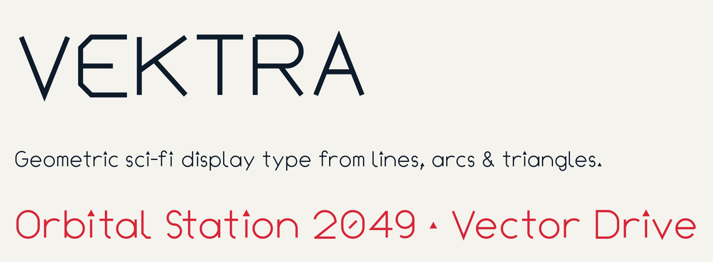
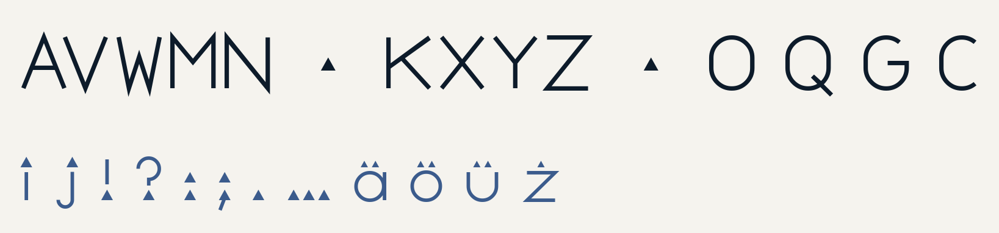
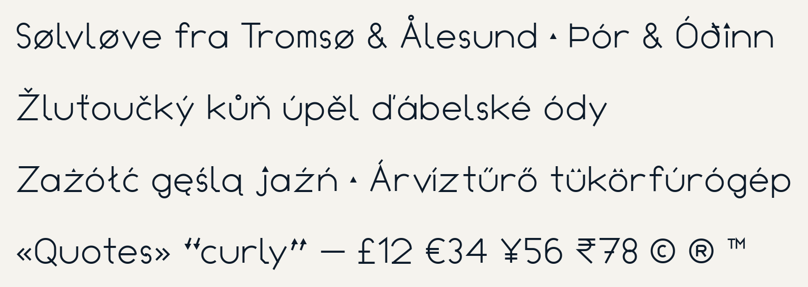
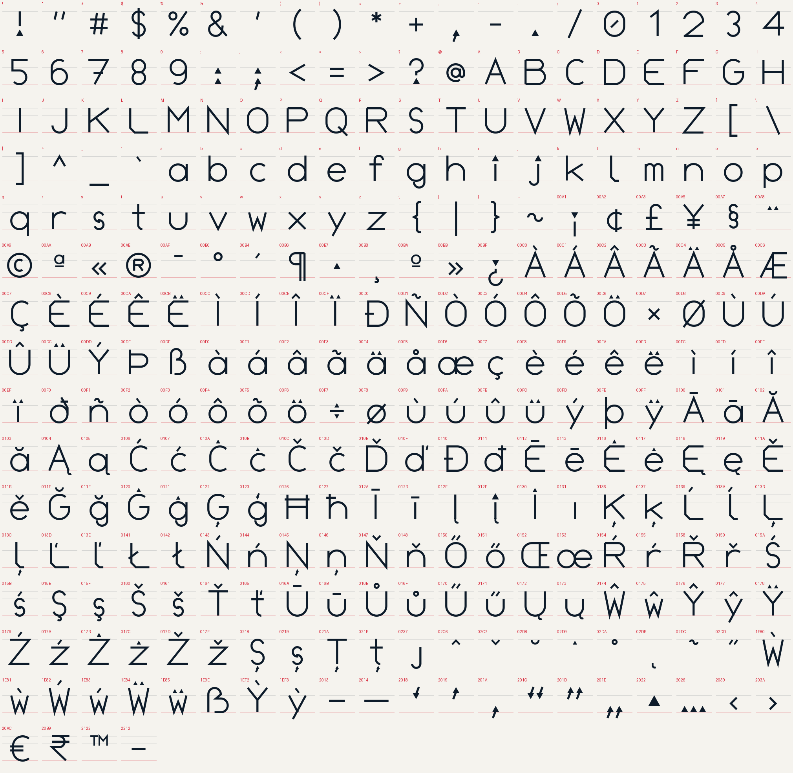

# Vektra



Vektra is a minimal geometric sci-fi display typeface. Every letter, figure, and symbol is built from straight lines and true circular arcs, drawn with one 60-unit monoline stroke with flat-cut terminals and needle-sharp mitred apexes. Its dots are solid triangles: the period, the colon, the dots on `i` and `j`, umlauts, and dot accents.

**[See the specimen](https://q78717.github.io/font-vektra/)** · **[Download the fonts](https://github.com/q78717/font-vektra/releases/latest)**

## Lines, arcs & triangles



- Capitals and figures are 700 units tall. Round capitals are stadiums: semicircles joined by straight sides.
- Lowercase sits on a 480-unit x-height, with full-circle bowls, 720-unit ascenders, and 200-unit descenders.
- Joins are mitred up to a ratio of 4, so `A`, `V`, `W`, and `M` keep sharp points instead of blunt bevels.

## Character set

Google Fonts' Latin Core set covers the Latin languages of Northern, Western, Central, and Eastern Europe (including `Æ`, `Ø`, `Å`, `Þ`, `Ð`, `Œ`, `ß`, `ẞ`). It also has curly quotes, guillemets, dashes, currency signs (`$`, `¢`, `£`, `¥`, `€`, `₹`), and combining accents positioned with `mark`/`mkmk`.



Vektra is a display face. It reads best at 24 px and up.



## Using the fonts

**Desktop:** download the latest release and install `Vektra-Regular.ttf`.

**Web:** use `Vektra-Regular.woff2`.

```css
@font-face {
  font-family: "Vektra";
  src: url("Vektra-Regular.woff2") format("woff2");
  font-display: swap;
}
```

## Building from source

Every glyph is a short Python function in `sources/build_vektra.py`. Each one describes a skeleton of lines and arcs, which is expanded into a monoline outline. Arcs get exact concentric offsets, written as quadratic curves. The script merges the strokes with `skia-pathops`, computes class kerning from glyph profiles, and writes the UFO source in `sources/ufo/`. [gftools builder](https://github.com/googlefonts/gftools) then compiles and hints the fonts. The repository follows the [Google Fonts project template](https://github.com/googlefonts/googlefonts-project-template).

```sh
make build    # sets up venv/ from requirements.txt, then runs sources/build.sh
make test     # checks the fonts with fontspector (cargo binstall fontspector)
make qa       # checks the fonts with FontBakery (googlefonts + universal profiles)
make proof    # HTML proofs in out/proof (cargo binstall diffenator3)
make images   # redraws the PNG images in documentation/
```

`sources/build.sh` runs the whole build in one command:

1. It writes `sources/ufo/`.
2. It compiles `sources/config.yaml` into `fonts/ttf/` and `fonts/webfonts/`.
3. It adds a `STAT` table.
4. It rebuilds `documentation/specimen/index.html`.
5. It runs `sources/tools/check_font.py`, a smoke test for Latin Core coverage, blank glyphs, dotless `i`/`j` substitution, mark attachment, kerning, and vertical metrics.

Dependencies are listed in `requirements.in`, and `make update` regenerates the pinned `requirements.txt`. FontBakery uses a separate environment built from `requirements-qa.txt`.

## Licence

Copyright 2026 The Vektra Project Authors. Vektra is licensed under the [SIL Open Font License 1.1](OFL.txt). You can use, modify, and redistribute it freely, including commercially, but you may not sell the fonts on their own.
